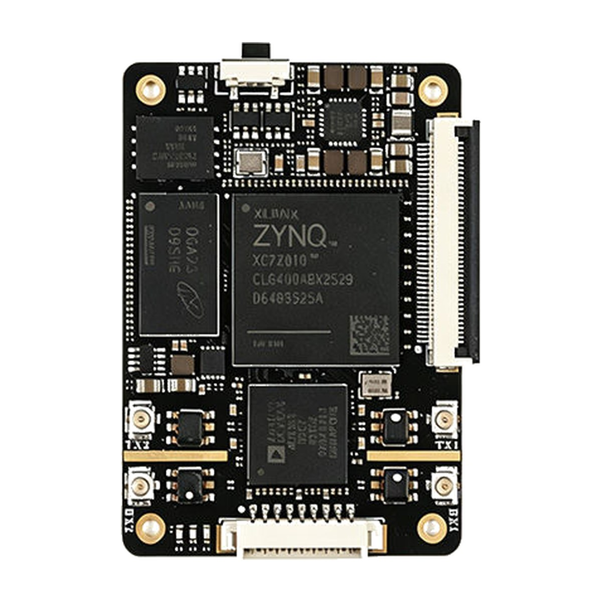
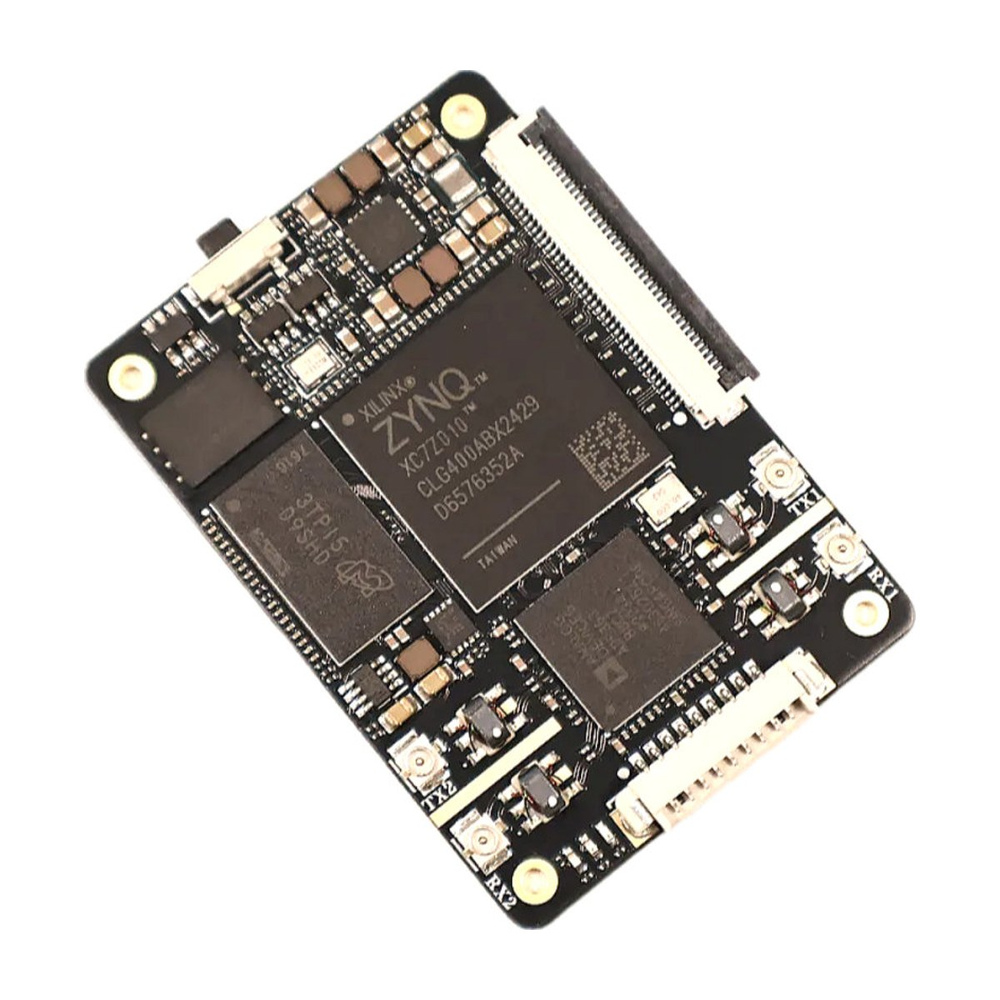

# 7010_AD9363_MINI

Schematic, Vivado reference design and bare-metal test application for the **OpenSourceSDRLab 7010-AD9363-MINI**, a 35 mm × 50 mm software-defined-radio module with a Xilinx Zynq-7010 SoC and the Analog Devices AD9363 RF transceiver (70 MHz – 6 GHz).

  
  

## Product link

<https://opensourcesdrlab.com/products/opensourcesdrlab-new-7010-ad9363-mini-70m-6ghz-development-board-35mm50mm-small-size>

## About the board

- RF transceiver: Analog Devices **AD9363**, two transmit and two receive channels (TX1/TX2, RX1/RX2) on IPEX connectors, 70 MHz – 6 GHz tuning range, 200 kHz – 20 MHz bandwidth
- SoC: Xilinx **Zynq-7010** (XC7Z010, CLG400 package)
- Memory: 512 MB DDR3, 32 MB Quad-SPI flash
- Clock: 40 MHz 0.5 ppm TCXO
- Interfaces: 9-pin MX1.25 connector with power input, JTAG and UART; 40-pin FPC connector with 15 LVDS pairs (extension GPIO) and power input
- Power supply: 5 V – 17 V through the MX1.25 or the FPC connector
- Boot: from the Quad-SPI flash at power-up; press the button on the board to switch to JTAG boot
- Size: 35 mm × 50 mm
- Reference design: Vivado / Vitis **2021.1**, Analog Devices HDL `hdl_2021_r1` and no-OS `2021_R1`, bare-metal (no OS)

## Quick start

1. Connect the debug adapter to the 9-pin connector, and TX1 to RX1 through an attenuator (20 dB or more).
2. Write `BOOT.bin` from the [Releases](../../releases) page to the Quad-SPI flash with Vivado, or load the prebuilt files over JTAG.
3. Open the serial console at 115200 baud and check the printed I/Q samples.

The full steps are in the **[Quick Start Guide](docs/Quick-Start-Guide.md)** ([PDF](docs/Quick-Start-Guide.pdf)).

## Repository layout

| Path | Contents |
|---|---|
| `hardware/` | Board schematic (PDF) |
| `vivado/AD936X_PL/` | FPGA design: Analog Devices HDL `hdl_2021_r1` (the libraries and the `fmcomms2` project), with the project `projects/fmcomms2/zc702` adapted to this board (XC7Z010, pin constraints, block design) |
| `vivado/AD936X_PS/` | Bare-metal application sources (Analog Devices no-OS AD9361 example, configured for this board) and the hardware platform `system_top.xsa` |
| `docs/` | Quick Start Guide (Markdown and PDF) |
| `images/` | Product photos |

## Downloads (Releases)

Large files are attached to the [Releases](../../releases) page instead of being stored in the repository:

| File | Contents |
|---|---|
| `7010_AD9363_MINI_prebuilt_Vivado2021.1.zip` | Prebuilt files: bitstream, `.xsa`, FSBL, application `.elf` and the flash boot image `BOOT.bin` |
| `SHA256SUMS.txt` | SHA-256 checksums of the files above |

Check a download with `shasum -a 256 -c SHA256SUMS.txt` (macOS / Linux) or `certutil -hashfile <file> SHA256` (Windows).

## Licence

Files created by OpenSourceSDRLab are released under the [Apache License 2.0](LICENSE). The reference designs come from Analog Devices and Xilinx/AMD and remain under their own licences; see [NOTICE.md](NOTICE.md).

## Support

- Email: support@opensourcesdrlab.com
- Forum: <https://forum.opensourcesdrlab.com>
- Discord: <https://discord.gg/nnxY6DkmvT>
- Blog and user manuals: <https://blog.opensourcesdrlab.com>

---
© 2026 OpenSourceSDRLab. All rights reserved. · <a href="https://www.opensourcesdrlab.com">www.opensourcesdrlab.com</a>
